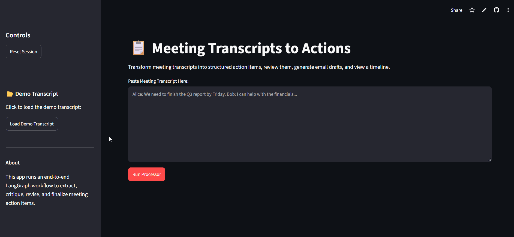
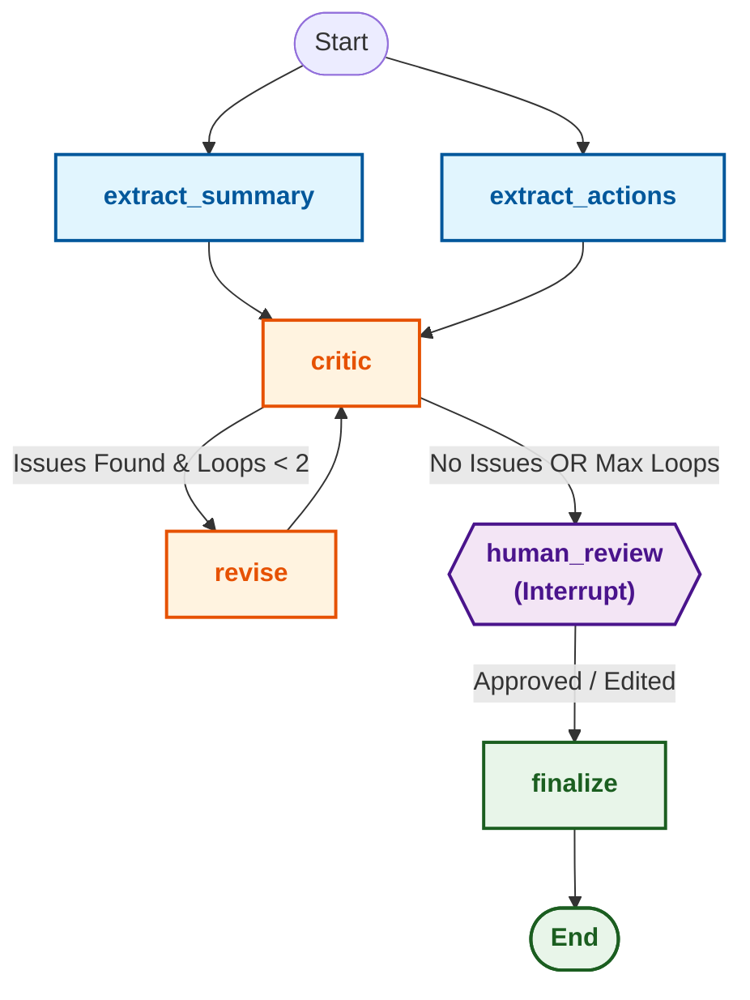

# Meeting Transcripts to Actions 🚀


Transform messy, unstructured meeting transcripts into executive summaries, validated action items with assigned owners and due dates, owner-grouped email drafts, and chronologically sorted timelines—powered by **LangGraph** and advanced LLMs with a strict **Human-in-the-Loop** review gate.

---

## 🎬 Demo



---

## 🧐 Overview & Problem Statement

Raw meeting transcripts are notoriously messy, dense, and prone to lost commitments. Action items get buried, owners are left ambiguous, due dates are forgotten, and follow-ups take hours to compile. 

**Meeting Transcripts to Actions** solves this by orchestrating a robust multi-agent graph workflow that:
1. **Extracts** structured summaries and action items in parallel without hallucinations.
2. **Critiques** extracted tasks for missing owners, invalid or missing due dates, and logical contradictions.
3. **Revises** data autonomously up to 2 correction loops.
4. **Pauses** for human review and interactive editing via a stateful **Human-in-the-Loop** checkpoint.
5. **Finalizes** outputs by grouping tasks by owner for email drafts and generating an end-to-end timeline.

---

## 🏗️ Architecture & LangGraph Workflow

The core engine is built using **LangGraph**, ensuring state immutability, checkpointing support, and clean cyclical routing.



### Key Graph Nodes:
- **`extract_summary`**: Generates a concise executive summary from the transcript.
- **`extract_actions`**: Extracts atomic action items with IDs (`a1`, `a2`, ...), source quotes, assignees, and YYYY-MM-DD due dates (strictly adhering to the transcript without inventing missing data).
- **`critic`**: Automated LLM reviewer checking for unassigned owners, invalid date formats, and contradictory tasks.
- **`revise`**: Corrects identified issues against the source transcript while preserving item stability.
- **`human_review`**: LangGraph interrupt checkpoint. Pauses execution to present extracted items and issues to the user for interactive approval, edits, or rejections.
- **`finalize`**: Groups approved items by owner, compiles draft emails per owner, and constructs a chronologically sorted timeline.

---

## ✨ Key Features

- **Parallel Fan-Out Extraction:** Summarization and action extraction run concurrently to optimize latency.
- **Self-Correcting Critique Loop:** Automated validation guards against hallucinations and missing fields before human review.
- **Stateful Human-in-the-Loop (HITL):** Built-in LangGraph checkpointing pauses execution safely, allowing operators to fine-tune tasks prior to finalization.
- **Zero-Hallucination Constraints:** Strict prompting rules ensure all assignees and due dates are explicitly grounded in the transcript text.
- **Actionable Outputs:** Automatically generates ready-to-send email drafts grouped by owner and a unified project timeline.

---

## 📊 Evaluation Results (M6)

The system is rigorously benchmarked against gold-standard test sets (`data/samples/`) evaluating extraction accuracy, precision, and recall.

| Sample Set | Gold Actions | Predicted | True Positives (TP) | False Positives (FP) | False Negatives (FN) | Precision | Recall | F1 Score |
| :--- | :---: | :---: | :---: | :---: | :---: | :---: | :---: | :---: |
| **Sample 1** | 3 | 3 | 3 | 0 | 0 | 1.00 | 1.00 | **1.00** |
| **Sample 2** | 2 | 3 | 2 | 1 | 0 | 0.67 | 1.00 | **0.80** |
| **Sample 3** | 2 | 2 | 2 | 0 | 0 | 1.00 | 1.00 | **1.00** |
| **Overall** | **7** | **8** | **7** | **1** | **0** | **0.88** | **1.00** | **0.93** |

---

## 🗂️ Project Structure

```text
meetingToActions/
├── app.py                # Streamlit interactive UI application
├── spec.md               # Detailed architectural specification & milestones
├── requirements.txt      # Pinned project dependencies
├── data/
│   ├── demo.txt          # Sample transcript for demonstration
│   └── samples/          # Gold standard evaluation samples (json & txt)
├── evals/
│   └── run_evals.py      # Automated precision/recall benchmark runner
├── prompts/              # Prompt templates (summarize, extract, critic, revise, email)
├── src/
│   ├── config.py         # Configuration & environment settings
│   ├── graph.py          # LangGraph state graph definition & compilation
│   ├── llm.py            # LLM client initialization (Groq / Gemini)
│   ├── nodes.py          # Graph node execution functions
│   ├── schemas.py        # Pydantic models (ActionItem, EmailDraft, State)
│   └── state.py          # TypedGraph state definitions
└── tests/                # Comprehensive unit and integration test suite
```

---

## 🚀 Installation & Quickstart

### 1. Clone the Repository
```bash
git clone https://github.com/your-username/meetingToActions.git
cd meetingToActions
```

### 2. Install Dependencies
```bash
pip install -r requirements.txt
```

### 3. Configure Environment Variables
Set your Groq API key (or Streamlit secrets):
```bash
export GROQ_API_KEY="your-groq-api-key-here"
```
*(Alternatively, configure `.streamlit/secrets.toml` for Streamlit deployment).*

### 4. Run the Streamlit App
```bash
streamlit run app.py
```

### 5. Run Evaluations & Tests
Execute the benchmark evaluation suite:
```bash
python evals/run_evals.py
```

Run pytest unit tests:
```bash
pytest
```
